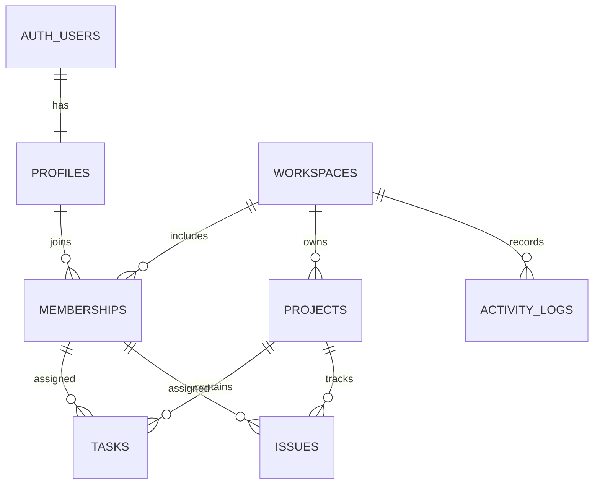

# ER図・データ辞書

P2-1でSQLマイグレーションを作成。IDはuuid、日時はtimestamptz。操作APIの提供範囲は[認証・DB基盤仕様](../specs/002-auth-database.md)を参照。

| テーブル | 列・制約 |
|---|---|
| profiles | id PK/FK auth.users.id、display_name（架空名） |
| workspaces | id PK、name、created_at |
| memberships | workspace_id + user_id 複合PK、user_id FK profiles、role(admin/member/viewer)、joined_at |
| projects | id PK、workspace_id FK、name、description、status、due_date、version、created_at、updated_at、UNIQUE(workspace_id,id) |
| tasks | id PK、workspace_id、project_id、title、description、status、priority、assignee_id nullable、due_date、position bigint、version、created_at、updated_at |
| issues | id PK、workspace_id、project_id、title、description、status、priority、assignee_id nullable、due_date、version、created_at、updated_at |
| activity_logs | id PK、workspace_id FK、project_id nullable、actor_id nullable、actor_display_name、entity_type、entity_id、action、changes jsonb、created_at |

tasks/issuesの(workspace_id,project_id)はprojects(workspace_id,id)を参照し、(workspace_id,assignee_id)はmemberships(workspace_id,user_id)を参照する。別スペースへの担当すり替えをDB制約でも拒否。所属解除RPCは担当解除後に所属を削除する。ユーザー削除も同じ順序で行う。workspace削除は初期対象外。

タイトル長・状態・優先度・version>=1をCHECKで制約。workspace_id/project_idは更新不可。FKは原則RESTRICT。タスク・課題の削除後も履歴を保持するため履歴entity_idにFKを張らない。

索引: memberships(user_id,workspace_id)、projects(workspace_id,status,id)、tasks(workspace_id,project_id,status,position,id)、issues(workspace_id,project_id,status,id)、activity_logs(workspace_id,created_at DESC,id DESC)、tasks/issues(workspace_id,assignee_id)。

サンプルは「デモスペース」「架空プロジェクトA〜C」「デモメンバー01〜03」。画面数値は固定の架空値。
