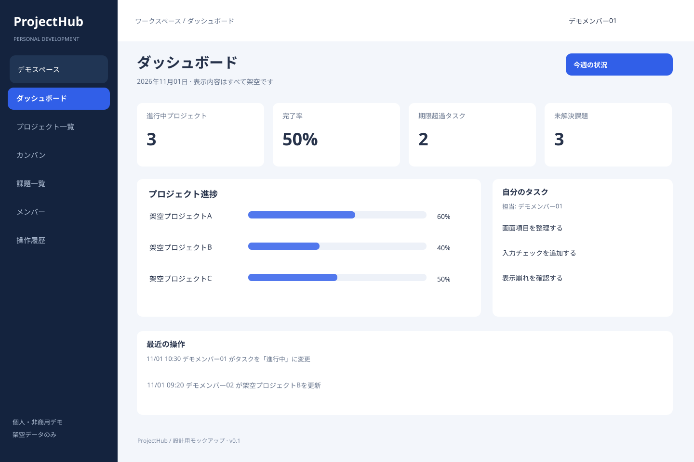
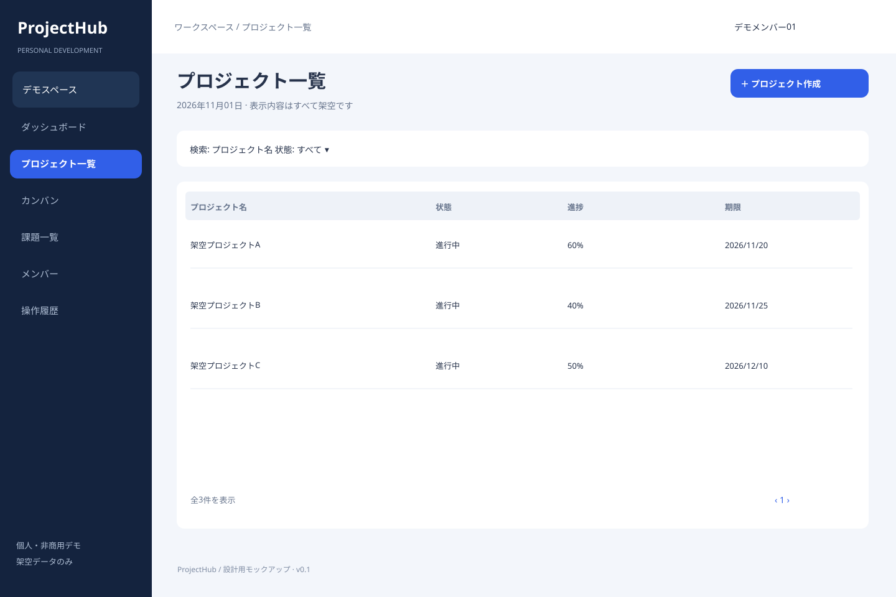
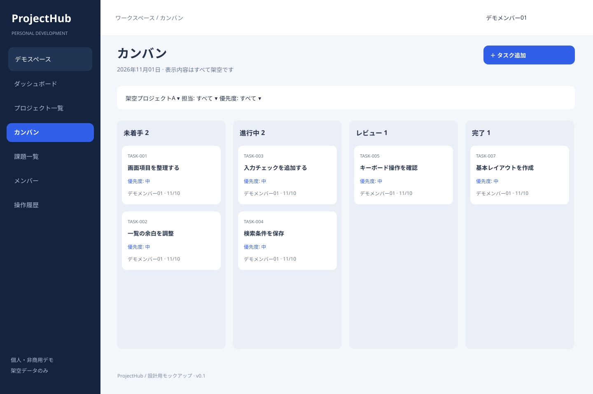
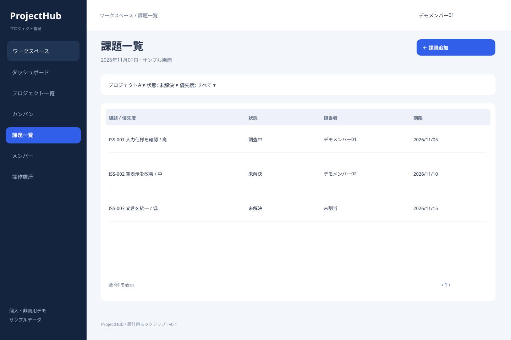
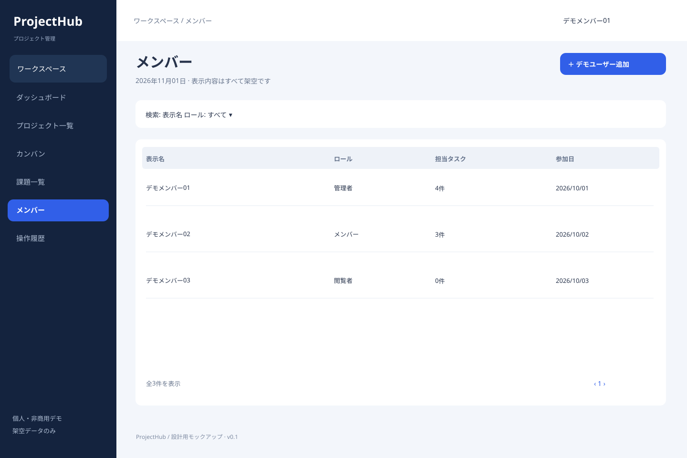
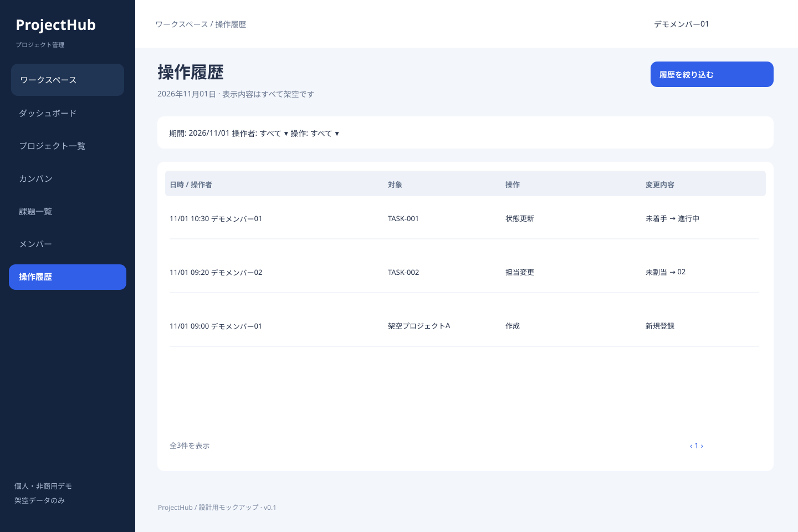

# 画面仕様・プレビュー

P3では接続モードのダッシュボード・プロジェクト一覧・カンバンをDB化。ダッシュボードはworkspace選択、4指標、進捗・本人タスク・最近の操作を表示。カンバンは追加/編集/削除、ドラッグ・状態メニュー・上へボタン、列ごとの追加読込を提供。実装契約は[ダッシュボード仕様](../specs/005-connected-dashboard.md)と[カンバン仕様](../specs/004-connected-kanban.md)を参照。以下のSVGは全機能完成時のデスクトップ案で、固定プレビューモードも引き続き利用可能。

全画面は設計用の静的SVG。ボタンは動作しません。表示値は架空です。共通色は濃紺・青・白、デスクトップ1440×960を基準とします。

## 1. ダッシュボード

表示・入力: 進捗・期限超過・課題数・自分のタスク。

操作: カードから対象プロジェクトや絞込一覧へ移動。集計は閲覧可能なスペース内のみ。

## 2. プロジェクト一覧

表示・入力: 検索・状態・名前・進捗・期限・作成ボタン。

操作: 検索は300ms待機後に適用。作成/編集はダイアログ。admin以外に作成操作を表示しない。

## 3. カンバン

表示・入力: プロジェクト・担当・優先度・状態列・タスクカード。

操作: 追加/クリックで詳細。ドラッグと状態選択メニューの両方で移動可能。失敗時は配置を戻す。

## 4. 課題一覧

表示・入力: プロジェクト・状態・優先度・件名・担当・期限。

操作: 行クリックで詳細、追加/編集ダイアログ。解決・再開を確認付きで実行。

## 5. メンバー

表示・入力: 表示名・ロール・担当数・参加日。

操作: adminのみ登録済みデモユーザー追加、ロール変更、所属解除。最後のadmin解除を拒否。

## 6. 操作履歴

表示・入力: 日時・操作者・対象・操作・変更内容。

操作: 期間/操作者/操作で検索。読取専用。対象クリックは存在・権限がある場合だけ詳細へ。

## 共通状態・スマートフォン

読込中はスケルトンとaria-busy。0件は説明と権限に応じた作成導線。失敗は内容を消さず再試行ボタン。送信中は二重送信を防ぐ。入力エラーは項目付近で説明しフォーカスを移す。409は再読込を案内し未保存入力を保持。権限不足は操作不可を明示。

768px未満はサイドバーをドロワーにし、カードを1列、一覧はカード形式、カンバンは状態タブに切り替える。360pxで検証。ダイアログは画面幅内に収め、フォーカストラップ・Esc・操作後のフォーカス復帰を実装する。SVGはデスクトップ案でありモバイル版はP1で検証する。
