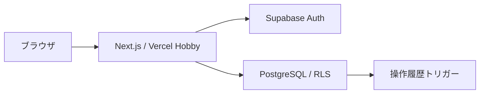
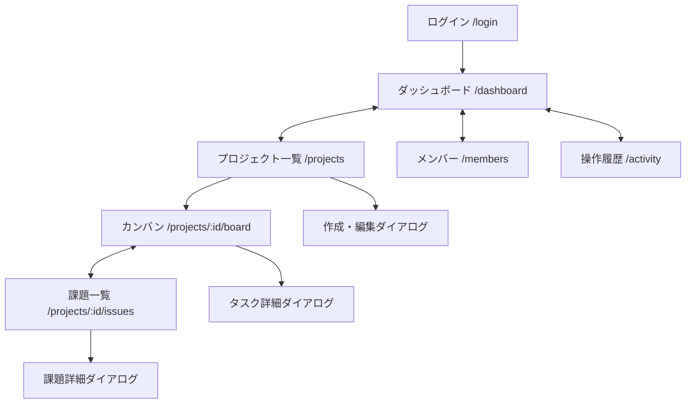

# 基本設計 v0.1

## 目的・範囲

Reactのコンポーネント設計、フォーム、API、認可、テスト、デプロイを個人開発で学ぶ。業務を模した架空デモであり、実運用や企業利用は対象外。MVPは認証・ダッシュボード・プロジェクト一覧・タスクCRUD・カンバン。続いて課題・メンバー・操作履歴を実装する。課金、顧客管理、添付ファイル、通知、ガント、リアルタイム同期は初期対象外。

## 権限とルール

ワークスペース単位で隔離する。adminは所属とプロジェクトを管理、memberはタスク・課題を編集、viewerは閲覧だけを行う。所属者は同じスペース内の全プロジェクトを閲覧できる。プロジェクト単位の非公開権限は初期対象外。

- プロジェクト状態: planned / active / archived。削除はアーカイブで代替。復元はadminのみ。
- タスク状態: todo / doing / review / done。任意の列間移動を許可。
- 課題状態: open / investigating / resolved / closed。優先度: low / medium / high。
- タイトル1〜120字、本文0〜5,000字、担当は同じスペースの有効所属者または未割当。
- 進捗は完了タスク数÷全タスク数。0件は0%。期限はdate、今日より前かつ未完了を期限超過とする。
- 日付判定はAsia/Tokyo、日時はUTC保存・日本時間表示。
- version整数による更新競合検出。409時は再読込。更新と履歴は単一DBトランザクション。
- アーカイブ内は閲覧のみ。所属解除時は担当解除し、過去の履歴の架空表示名は保持する。

## 技術構成

Server Componentsで読取、Client Componentsでカンバンとフォームを実装。Next.js Route HandlersをAPI境界とし、SupabaseにユーザーJWTを渡す。URLと局所stateを優先し、追加状態管理は必要時に検討。フォームはReact Hook Form / Zodを候補とする。

## 画面遷移

共通サイドバーから全体画面へ移動。カンバンと課題は選択中プロジェクトを使い、未選択なら一覧へ誘導する。フィルターはURLに保持。未認証はログインへ戻しreturnToを同一サイト相対パスに限定。無所属と不存在は同じ404。ログアウトはセッションを破棄する。

## 品質・運用

認証済みデータを共有キャッシュしない。入力検証、同一Originの更新要求検証、HTTPSを使用。トークン・本文をログに出さない。キーボード操作、ラベル、フォーカス管理、AA相当のコントラスト、360px幅を確認する。

性能目標は架空100プロジェクト・1,000タスクで一覧API p95が1秒以内（[ローカル単一ユーザー条件で測定済み](performance.md#100プロジェクト1000タスクのローカル一覧api検証)、本番負荷は未測定）。初期25件、上限100件。自動ポーリングはしない。

Vercel Hobbyは個人非商用の学習デモに限定。無料枠の容量・バックアップを保証として扱わない。開発と本番のSupabaseを分離し、Previewは本番DBにつながない。公開前に利用条件と上限を再確認し、超過時は停止・縮小してプランを再検討する。

参考（2026-11-01確認）: [Vercel Hobby](https://vercel.com/docs/plans/hobby)、[Supabase RLS](https://supabase.com/docs/guides/database/postgres/row-level-security)。
