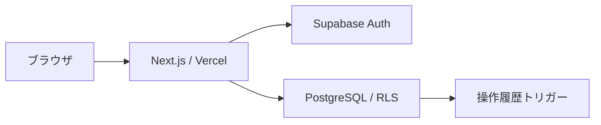
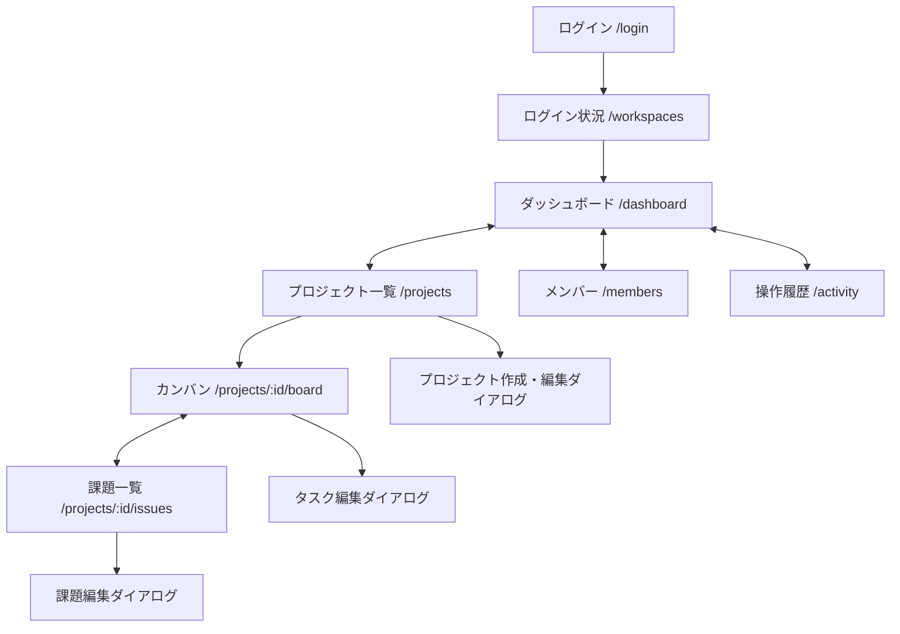

# 基本仕様

仕様023〜030は実装・統合検証中です。本書の追加機能の説明は実装契約であり、本番での利用開始を示しません。本番の適用・確認記録は[公開・運用手順](deployment.md)を参照してください。

ProjectHubは、ワークスペースごとにプロジェクト・タスク・課題を管理するWebアプリです。ここでは現在の機能に共通するルールを定義します。操作方法は[利用ガイド](user-guide.md)、機能別の受け入れ条件は[仕様一覧](specs/README.md)を参照してください。

## 機能と権限

所属メンバーは、公開範囲が`workspace`のプロジェクトを閲覧できます。`private`は同じワークスペースの管理者と指定した参加者だけが閲覧できます。以下の業務操作は、対象プロジェクトを閲覧できることが前提です。他のワークスペースのデータは参照できません。

| 操作                                                             | 管理者 `admin` | メンバー `member` | 閲覧者 `viewer` |
| ---------------------------------------------------------------- | -------------- | ----------------- | --------------- |
| ダッシュボード・プロジェクト・タスク・課題・メンバー・履歴の閲覧 | 可             | 可                | 可              |
| プロジェクトの作成・編集・アーカイブ・復元                       | 可             | —                 | —               |
| タスク・課題の作成・編集・削除                                   | 可             | 可                | —               |
| 課題コメントの投稿                                               | 可             | 可                | —               |
| 課題コメントの編集・削除                                         | 可             | 投稿者本人のみ    | —               |
| タスクの状態変更・並べ替え                                       | 可             | 可                | —               |
| 自分の表示名変更                                                 | 可             | 可                | 可              |
| 登録済みユーザーの所属追加、ロール変更、所属解除                 | 可             | —                 | —               |

アーカイブ済みプロジェクトのタスク・課題・コメントは、全ロールで閲覧のみです。管理者はプロジェクト自体の編集と復元ができます。最後の管理者を失うロール変更・所属解除は拒否します。

表示名は「ログイン状況」で本人が変更でき、所属先の有無を問いません。前後の空白を除いて1〜80文字です。変更後のメンバー一覧・担当者候補に反映し、過去の履歴とコメントの投稿者名は保持します。

## 状態と入力

| 対象         | 状態                                                                                  |
| ------------ | ------------------------------------------------------------------------------------- |
| プロジェクト | `planned`（計画中）/ `active`（進行中）/ `archived`（アーカイブ）                     |
| タスク       | `todo`（未着手）/ `doing`（進行中）/ `review`（レビュー）/ `done`（完了）             |
| 課題         | `open`（未解決）/ `investigating`（調査中）/ `resolved`（解決済み）/ `closed`（終了） |

タスク・課題の優先度は`low` / `medium` / `high`です。タスクは任意の状態間で移動できます。課題は解決後も編集・再開できます。

名前・件名は前後の空白を除いて1〜120文字、説明は0〜5,000文字です。担当者は同じワークスペースに所属し対象プロジェクトを閲覧できる利用者、または未割当です。所属解除時はタスク・課題の担当を解除します。プロジェクトは削除せず、アーカイブで管理します。

## 集計と日時

- 進捗は完了タスク数 ÷ 全タスク数。タスク0件は0%とします。
- ダッシュボードの完了率は、アーカイブ以外の全タスクから計算します。プロジェクト別の完了率の平均ではありません。
- 期限超過は、日本時間で今日より前が期限の未完了タスクです。期限は日付として保存します。
- メンバーの担当件数は、計画中・進行中プロジェクトの未完了タスクと未解決課題を集計します。
- 操作日時はUTCで保存し、日本時間で表示します。履歴の期間検索は、日本時間の開始日・終了日の両方を含みます。

## 更新・競合・操作履歴

プロジェクト・タスク・課題・所属・コメントの更新は整数の`version`で競合を検出します。タスク移動では移動対象だけを更新し、並び順の内部調整で他タスクのversionと更新日時を変更しません。競合時は409を返し、画面では未保存の入力を保持したまま最新版の読み直しを案内します。

作成APIは`Idempotency-Key`による24時間の再送に対応します。同じキー・同じ本文は初回の受付結果を返し、本文が異なる場合は409です。変更と監査ログは、単一のDBトランザクションで保存します。APIごとの詳細は[API・認可設計](architecture/api-rls.md)を参照してください。

操作履歴は閲覧専用で、無期限に保持し、自動削除しません。対象の削除や所属解除後も、操作当時の表示名と記録を保持します。本文などの詳細値は記録しません。管理者は月次に件数・容量・最古日時を確認します。保持期間の短縮は別Issueで移行と保存方法を決め、利用者への影響を確認してから実施します。[保持方針と運用](specs/021-auth-and-log-operations.md)を参照してください。

## 課題コメント

課題一覧の「コメント」から開き、投稿・閲覧・編集・削除を行います。本文は1〜5,000文字のプレーンテキストで、最新順に表示します。投稿者名は投稿時の表示名を保持します。解決・終了済みの課題にも投稿できます。課題を削除するとコメントも削除しますが、本文を含まない操作履歴は保持します。[詳細仕様](specs/016-issue-comments.md)を参照してください。

## 構成と画面遷移

読取はServer Components、フォームとカンバン操作はClient Componentsを使用します。Next.js Route HandlersをAPI境界とし、SupabaseへユーザーJWTを渡します。フォームは標準のフォーム要素とReactの状態管理で実装しています。

ログイン後は`/workspaces`でログイン状況と所属先を確認できます。共通メニューから各画面へ移動します。カンバン・課題はプロジェクトを選んで開きます。

検索条件とページ送りはURLに保持します。接続モードの未認証アクセスはログインへ誘導し、無所属のIDと存在しないIDへのアクセスは同じ404を返します。ログアウト時はセッションを破棄します。

## 品質と運用

認証済みデータは共有キャッシュへ保存しません。APIで入力・Origin・認可を検査し、DBでも制約と権限を検査します。本番通信にはHTTPSを使用します。通常のAPIで管理鍵を使いません。

画面にはラベル・エラー表示・キーボード操作・フォーカス管理を用意し、360px幅を検証します。読込・空・失敗・送信中の状態を扱い、自動ポーリングは行いません。一覧は既定25件・最大100件です。

100プロジェクト・1,000タスクで一覧APIのp95が1秒以内という目標は、ローカル単一ユーザー条件で測定済みです。本番の高負荷時性能は未測定です。[測定条件と結果](performance.md)を参照してください。

開発・本番のDBを分離し、Vercel PreviewはDBに接続しません。公開環境は個人・非商用の学習用途で運用します。設定・公開・切り戻しは[運用手順](deployment.md)、データの扱いは[開発ルール](../CONTRIBUTING.md#データと認証情報の扱い)、未対応機能は[対応状況](roadmap.md)にまとめています。

## 追加機能の契約（実装・検証中）

- 一般登録・再設定・メール招待は接続モードかつ`SELF_SERVICE_AUTH_ENABLED=true`で提供します。本番は送信元ドメイン・Fromが未決定のため無効のままです。確認リンクのGETでは認証せず、確認ボタンのPOSTでメール所有を確認します。招待はさらに本人の明示承諾が必要です。認証済み本人はワークスペースを作成でき、作成者だけが管理者になります。
- プロフィールは表示名に加え、任意の役職・担当（80文字まで）と自己紹介（500文字まで）を本人が変更します。本人と共通ワークスペースの所属者だけが閲覧できます。過去の履歴・コメントの表示名は保持します。
- タスクの開始日は任意です。開始日と期限の両方がある場合、開始日が期限以前であることを要求します。ガントは日（14日）・週（12週）表示、25件ずつのページ送りで、日程編集はカンバンで行います。期間未設定・表示期間外も明示します。
- 非公開プロジェクトの作成・公開範囲・参加者管理は管理者だけが行います。参加してもワークスペースのロールは変わりません。非参加者には一覧・集計・履歴も見せません。参加解除・降格などで閲覧できなくなった担当者は未割当になります。過去の履歴も現在の公開範囲で絞ります。
- 通知は担当割当と課題の新しいコメントが対象です。自分自身の操作は通知せず、本人かつ現在も対象を閲覧できる場合だけ表示します。通知は90日保持し、本文・タイトル・操作者名をコピーしません。メール・Push通知は対象外です。
- 添付は保存済みタスク・課題ごとに予約を含め20件、1ファイル最大3MiBです。PNG・JPEG・WebP・PDF・UTF-8テキストを許可します。非公開Storageと現在の閲覧権限で保護し、投稿はadmin/member、削除は投稿者または管理者、アーカイブでは閲覧だけです。内容識別の検査をウイルス検査の保証とは扱いません。
- Realtimeは本人宛ての汎用INSERT通知から通常の読取を再実行します。業務本文を配信せず、編集中・ダイアログ表示中などは「更新があります」と案内して入力を保持します。権限失効後の保存はAPI/RLSで拒否します。Previewでは接続しません。

詳細な入力・権限・保持契約は[仕様023〜030](specs/README.md#実装統合検証中の追加仕様)を参照してください。
